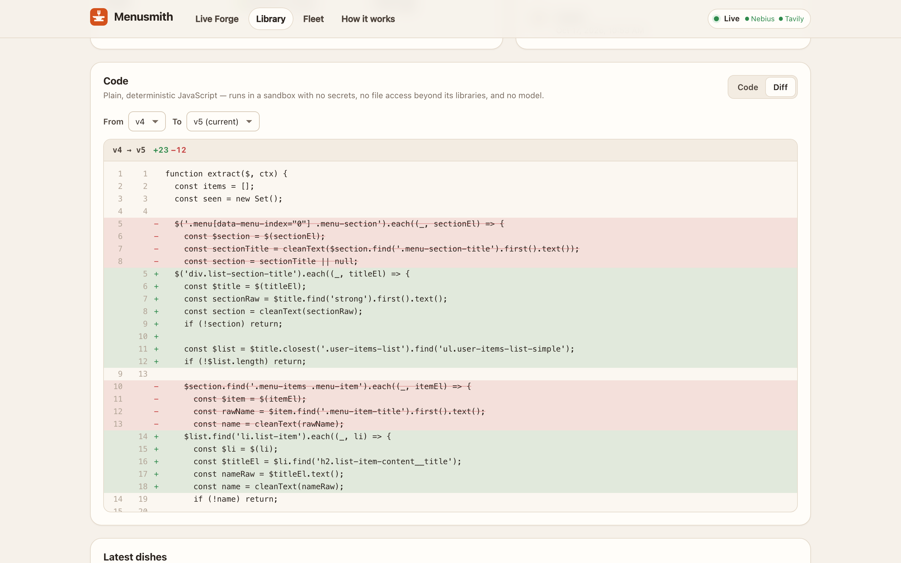
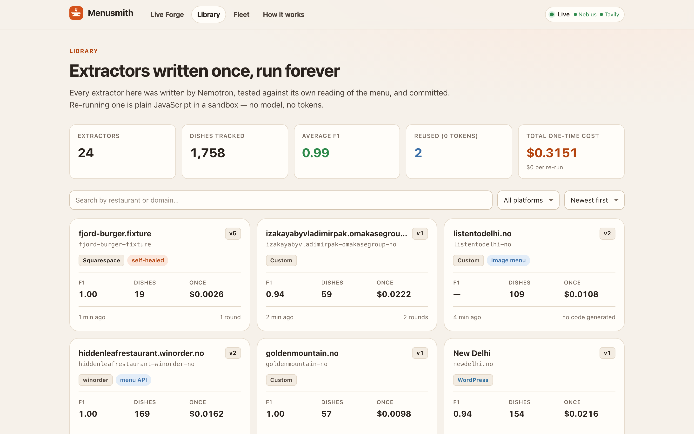
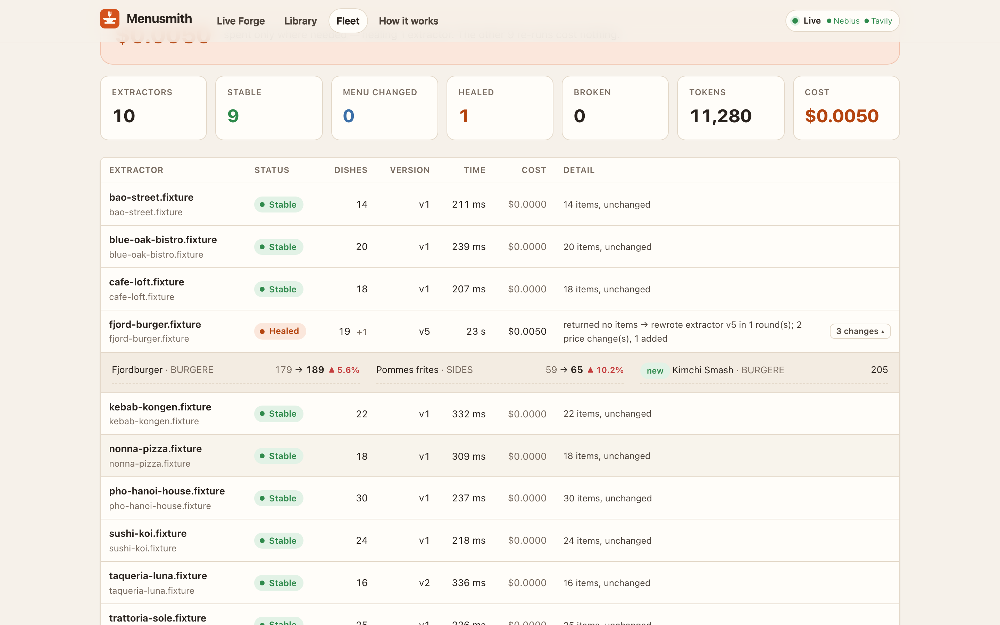
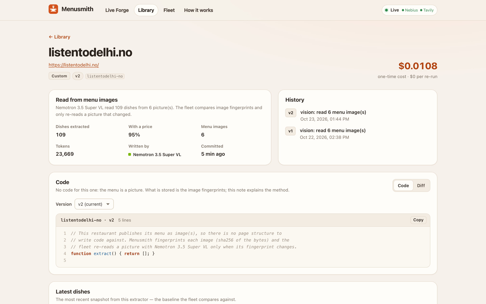
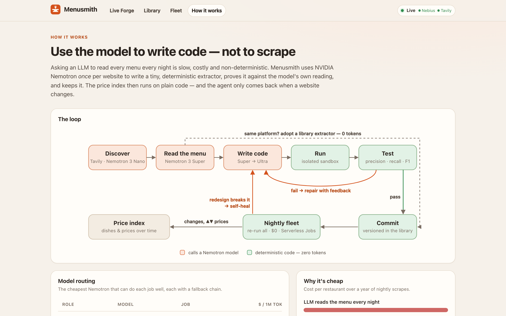
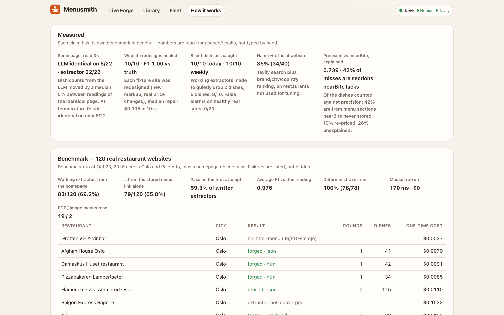
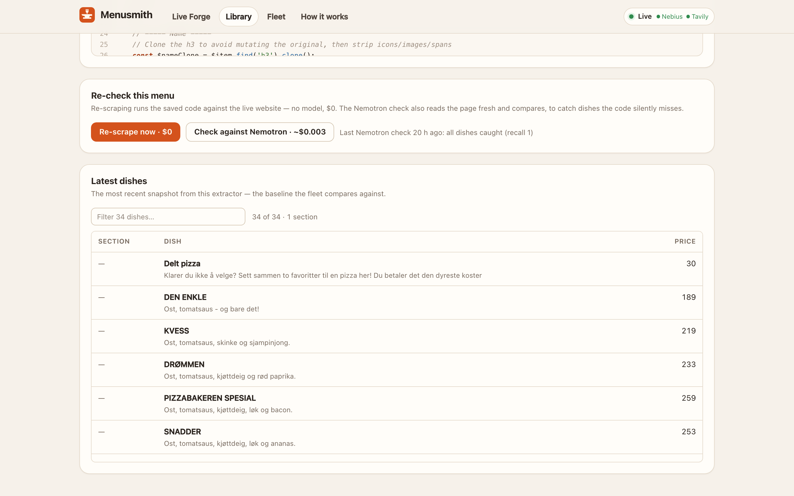

# Menusmith

**Agents that write the scraper once — so the price index runs forever.**

Menusmith turns any restaurant website into a live, deterministic price feed. A team of
**NVIDIA Nemotron** agents on **Nebius Token Factory** reads a restaurant's menu, **writes a small
extractor program for that one website, runs it in a sandbox, tests it against its own reading,
and repairs it until it passes**. After that, every re-scrape is plain JavaScript: **zero tokens,
same answer every time**. When a website redesign breaks an extractor, the fleet notices and the
agent heals its own code.

> Nebius × NVIDIA Global AI Hackathon 2026 · Track: **Coding and Agentic Engineering**
> **Live demo: https://menusmith.onrender.com** (free tier — the first request after a quiet spell takes ~1 min to wake up) · Demo video: _(link)_

> **Judges — a 2-minute tour.** On **Live Forge**, click a real restaurant (Burma Superstar, a PDF
> menu, an image menu) or type any restaurant you know — by URL or just its name and
> city. On **Discover**, try *“pizza in San Francisco”* → **Forge all** → the price index. On
> **Fleet**, flip **Fjord Burger** in *“Demo: simulate a website redesign”* → **Run fleet now** →
> open the healed extractor and its **version diff**. On any extractor page, **Re-scrape now** ($0)
> and **Check against Nemotron** show the coverage check. Offline, no key: `npm ci && npm run demo`.

---

<p align="center">
  
  <br><em>Self-healing: the restaurant redesigned its website, the fleet noticed, and the agent rewrote its own code — the diff between the old and the healed version.</em>
</p>

## Why

We run [nearBite](https://github.com/PhilipFlo), a dish-level restaurant search for Oslo and
Palo Alto: **1,036 restaurants and 78,682 dishes** scraped from restaurants' own websites, with
**20,045 menu changes** tracked since June 2026. Keeping that fresh the usual way — asking an LLM
to re-read every menu, every month — has three problems:

1. **Cost and speed.** Every re-scrape pays for a full LLM reading of every page.
2. **Noise.** LLM extraction is not deterministic. We measured it (`bench/variance.ts`): reading
   the *identical* page three times with Nemotron gave the same dish list on only **5 of 22** real
   sites; dish counts moved by a median **5%** and up to 18%, and one reading of one site came back
   empty. Even at **temperature 0** only 5 of 22 came back identical (15 sites still changed
   their dish count). The written extractors returned identical output on **22/22**. In a price
   *time series*, that noise looks like menu changes.
3. **Half the web is JavaScript.** Ordering systems and site builders ship an empty HTML shell
   and load the menu from an API.

Menusmith moves the LLM to where it's worth it — **writing and repairing code** — and out of the
hot path.

**Beyond menus.** Menus are the test bed, not the limit: the same loop (read once, compile an
extractor, verify, re-run for free, heal on change, check for silent misses) fits any structured
data spread over thousands of slightly different websites — grocery prices for inflation baskets,
rental listings, job postings, tenders, product specs. Wherever a time series must be cheap to
refresh and must not invent changes, the model belongs in the build step.

## How it works

```mermaid
flowchart LR
  A[URL or name] -->|Tavily search + map| B[Find menu page]
  B --> C{Menu in HTML?}
  C -- yes --> D[HTML]
  C -- no --> E[Headless browser<br/>capture menu API JSON]
  D --> F[Oracle<br/>Nemotron 3 Super reads the menu]
  E --> F
  F --> G{Library extractor<br/>for this platform passes?}
  G -- yes --> K[Adopt — 0 tokens]
  G -- no --> H[Forge<br/>Nemotron 3 Super writes extract()<br/>escalates to Ultra if stuck]
  H --> I[Sandbox run + score<br/>precision · recall · F1]
  I -- disputed items --> J[Arbitrate<br/>Nemotron 3 Nano]
  J --> I
  I -- fail --> H
  I -- pass, deterministic --> K[Commit to library]
  K --> L[Fleet re-runs nightly<br/>scheduled job, 0 tokens]
  L -- drift detected --> F
```

1. **Find** — given a name, Tavily search finds the official site (aggregators filtered out);
   Tavily map + Nemotron Nano triage find the menu page among the site's links.
2. **Acquire** — the menu is taken in its most stable form:
   - **server HTML** → plain HTTP re-runs;
   - **a menu API** — a headless browser renders the page and **captures the JSON the page loads**;
     the extractor is written over that JSON and re-runs replay the request directly;
   - **rendered DOM** for menus that only exist after JavaScript runs;
   - **PDF menus** — text layer extracted locally with pdf.js, read by Nemotron 3 Super;
   - **image menus** — read by **Nemotron 3.5 Super VL**.
   PDFs and images have no structure to write code against, so Menusmith **fingerprints the
   file (sha256)** instead: the fleet re-reads it only when the bytes change — re-runs stay free.
3. **Oracle** — Nemotron 3 Super reads the visible page (or the API data) and writes down the menu.
   Items whose names don't occur on the page are dropped (hallucination guard).
4. **Forge** — Nemotron 3 Super, with reasoning on, writes `extract($, ctx)` (cheerio) or
   `extract(data, ctx)` (JSON) against a compact skeleton of the page: the menu region is located
   by price density and long runs of identical items are collapsed.
5. **Test** — the code runs in an isolated sandbox and is scored against the oracle. Code that
   hard-codes dish names is rejected. Duplicates always count as errors.
6. **Arbitrate** — when the code and the reading disagree on specific items (add-on options,
   promo banners, a dish the reading skimmed past), **Nemotron 3 Nano rules on each one** and both
   sides are corrected. The extractor is only penalised for real mistakes.
7. **Repair + escalation** — failures go back as concrete feedback (missing dishes, wrong
   prices, duplicates, runtime errors with line numbers, a selector-by-selector execution
   trace, or the exact JSON paths that hold dishes). If two rounds don't fix it, **Nemotron 3
   Ultra takes over the same conversation**. Repairs stop early if they stop improving.
8. **Commit** — only after a second run proves the output is deterministic.
9. **Fleet** — re-runs every extractor at zero token cost. Unchanged → stable. Plausible change →
   recorded as price changes. Broken (0 items, collapsed count, lost prices) → the oracle checks
   whether the menu really shrank; if not, the agent rewrites the extractor from its old code plus
   the new page: **self-healing**.
   **Silent misses are caught too.** A small drop ("2 dishes gone") looks like a normal menu
   change, so the fleet never records a removal on trust: it asks Nemotron to read the page fresh
   and compares. Dishes that left the output but are still on the page mean the *code* is wrong →
   it is rewritten — and the rewrite only passes once those dishes are back. Weekly, each extractor
   is also re-read: if it now returns clearly fewer dishes than when it was accepted while the
   menu did not shrink, it is rewritten too. Single readings are noisy, so a flag (or a removal)
   needs a second reading to agree before anything changes. Anyone can trigger the check from the
   extractor page (**Re-scrape now · $0** / **Check against Nemotron**).
10. **Reuse** — before writing new code, extractors from sites on the same platform (Squarespace,
    WordPress, or hosted ordering systems like Winorder/Ordera) are tried first — zero tokens.

## Results

**Ground truth — 10 fictional restaurant sites** (`fixtures/sites`, true menus known): average F1 **1.0** against the truth, 10/10 perfect, 10/10 deterministic.

**Self-healing, measured** (`bench/heal.ts`): each fixture site gets a fresh extractor, then its
website is **redesigned** (new markup *and* real price/dish changes). The nightly fleet noticed and
rewrote the extractor on **10/10** sites; afterwards every one scores **F1 1.0 against the true
redesigned menu**. Median repair: **$0.005, 10 s**.

**Silent misses, measured** (`bench/coverage.ts`, `bench/false-alarms.ts`): we made working
extractors quietly drop dishes. Losing 2 dishes today: **10/10** caught and rewritten correctly;
an older loss of 2 dishes found by the weekly check: **10/10**; of 5 dishes: **7/10**. The
controls: when the *restaurant* really removes dishes, the change is recorded and working code
is left alone (**9/9**, 0 rewrites), and the weekly check flagged **0 of 20** healthy real-site
extractors. Repairs that fail are retried at most twice a week, so a hard case can't run up costs.

**Unusual layouts:** site builders like Tilda put all dish names in one block and all prices in
another, paired only by position. Menusmith detects this, rebuilds the text in reading order for
the reader and gives the code a tested pairing helper — miaoceanfront.com went from F1 0.03 to
**0.99 on the first try** (verified against the rendered page).

**From just a name** (`bench/tavily.ts`): Tavily search plus our ranking found the restaurant's
official website from *name + city* for **80%** of 40 benchmark restaurants and **85%** of 40
held-out ones (several “misses” are the restaurant's own site where nearBite stored an ordering
platform).

**A visitor types a US restaurant they know** (`bench/judge-sim.ts`): 22 restaurants by *name + city
only* — San Francisco, Palo Alto, New York, Chicago, Seattle, Miami, Nashville, Los Angeles, Austin;
famous places, small ones and chains. **20/22 got a menu** (19 saved as extractors or readings, 1
near miss shown as Nemotron's reading): 13 from the restaurant's own site (6 HTML, 7 rendered),
6 from a public listing when the own site blocks automated visitors or shows no prices. Total
**$0.38**, median **85 s** on the free-tier settings. The 2 others block automated visitors and
have no public listing with prices — Menusmith says so instead of guessing.

**Real restaurant websites — 120 sites in Oslo and Palo Alto** (sampled across WordPress, Squarespace, Wix, Webflow, hosted ordering systems and custom sites):

| Metric | Result |
|---|---|
| Extractor committed, starting from the stored menu URL | **79/120 (65.8%)** |
| …including the homepage rescue pass (discovery + vision) | **83/120 (69.2%)** |
| Passed on the first attempt | 59.3% of forged extractors |
| Adopted from the library (zero new code) | 5 sites |
| Deterministic on re-run (3 runs, identical output) | 100% (78/78 measured) |
| Median one-time cost per site | $0.0109 |
| Median re-run time | 170 ms, **$0** |
| Precision vs. nearBite's independently scraped menus | 0.737 |
| Same page read 3× — LLM vs. extractor (22 sites) | LLM identical on 5/22 (also 5/22 at temperature 0) · extractor identical on **22/22** |
| Source mix of successes | json: 9 · html: 34 · rendered: 19 · image: 2 · document: 19 |

Remaining failures after the rescue pass: no-html-menu (JS/PDF/image) 11 · extractor-not-converged 15 · unreachable 2 · llm-error 1 · blocked 7 · other 1.

_Recall against nearBite is lower by design: nearBite merges several pages of a site, Menusmith extracts one menu page._

_Where precision against nearBite goes_ (`bench/precision.ts` — exactly the 1,030 dishes counted
against precision on the 44 sites with a stored reference): **42%** come from menu sections
nearBite never stored (e.g. it kept only the dinner menu), **19%** are the same dish at a different
price (re-priced since nearBite scraped it, or our error), **12%** are drinks and add-ons, **1%**
duplicates, and **26%** are unexplained — that group includes real extractor mistakes._

All numbers above are generated from `bench/results/*.json` by `npx tsx bench/report.ts` — one
benchmark run over all 120 sites (Oct 23, 2026), plus one rescue pass that restarts
failed sites from the restaurant's homepage. Failures are kept and categorised, not hidden: sites
that block automated visitors (HTTP 403/429) are not bypassed by design.

## How we use NVIDIA Nemotron on Nebius Token Factory

Every model call goes through Token Factory's OpenAI-compatible API
(`https://api.tokenfactory.nebius.com/v1/`). Models are routed by job — the cheapest model
that does each job well:

| Role | Model | Why | Settings |
|---|---|---|---|
| Triage (menu links), arbitration | `nvidia/NVIDIA-Nemotron-3-Nano-30B-A3B` | many small yes/no calls, $0.06/M in | thinking off, JSON mode |
| Oracle (read the menu) | `nvidia/nemotron-3-super-120b-a12b` | long structured extraction, 262K context | thinking off, JSON mode, chunked |
| Forge + repair (write code) | `nvidia/nemotron-3-super-120b-a12b` | solves most sites in 1–2 rounds at a third of Ultra's price | thinking **on**, multi-turn with test feedback |
| Escalation (hard repairs) | `nvidia/Nemotron-3-Ultra-550b-a55b` | strongest reasoning, only when Super is stuck | thinking **on**, continues the same conversation |
| Vision (image menus) | `nvidia/Nemotron-3.5-Super-VL` | reads menus published as pictures (~$0.002 per image) | JSON mode; images fingerprinted so re-runs don't call it |

- Reasoning is toggled per call with `chat_template_kwargs.enable_thinking`; the model's reasoning
  (`message.reasoning`) is streamed into the UI's "Agent thinking" panel.
- Each role has a fallback chain (e.g. Ultra → Super) for rate limits or outages.
- Every call is metered (tokens, $) into a per-job ledger shown live in the UI.
- `MENUSMITH_LLM=record` saves every response; `replay` re-serves them — tests and the offline
  demo run with **no API key**.

**Where Token Factory accelerated us:** one OpenAI-compatible endpoint for four Nemotron sizes
meant model routing was a config change, not an integration; JSON mode and the thinking toggle
made the cheap calls cheap and the code-writing calls smart.

### Other Nebius services and Tavily

- **Hosting is portable.** The public demo runs on a free host (`Dockerfile.slim` on Render,
  library mirrored to a token-gated Postgres table, nightly fleet on GitHub Actions — see
  `deploy/RENDER-SETUP.md`). The full image with the headless browser deploys to **Nebius AI
  Cloud Serverless** — an Endpoint for the app and a Job for the nightly fleet
  (`deploy/nebius.sh`, `deploy/NEBIUS-SETUP.md`); the public demo does not run there.
- **Tavily** — `/search` finds a restaurant's official website from its name (ranked by brand
  name in the domain, city and country — 85% correct on held-out restaurants, see Results);
  `/map` discovers the menu pages of a site when the homepage doesn't link them clearly; when a
  site blocks automated visitors, `/search` with page text finds a public listing (or a PDF menu)
  that names the restaurant. **Discover** turns one `/search` into a small price index: “pizza
  in San Francisco” → Nemotron Nano names the restaurants in the results (kept only if the name
  is really there) → each is forged → every dish compared across them, cheapest first.

## Screenshots

| Library — every extractor, its source and one-time cost | Fleet — nightly re-runs at $0, healing what broke |
|---|---|
|  |  |
| **Image menu** — read by Nemotron 3.5 Super VL, re-checked by fingerprint | **How it works** — model routing and the sandbox |
|  |  |
| **Measured** — every claim has its own benchmark | **Re-check** — re-scrape for $0, or compare with a fresh Nemotron reading |
|  |  |

## The sandbox

Model-written code never runs in the server process. Each run is a fresh Node process with:

- an **empty environment** — no API keys exist to steal;
- Node's **permission model** — no file writes, no child processes, no workers, reads limited to
  the harness and `node_modules`;
- `--disallow-code-generation-from-strings` — `eval`/`Function` (and the classic
  `this.constructor.constructor` escape) fail;
- a `vm` context exposing only `$`/`data`, `ctx`, `parsePrice`, `cleanText`; 4 s CPU timeout,
  256 MB heap, 12 s wall-clock kill.

These properties are covered by tests (`tests/sandbox.test.ts`).

## Quickstart

```bash
git clone https://github.com/PhilipFlo/menusmith && cd menusmith
npm install
npx playwright install chromium   # for JavaScript-built menus
cp .env.example .env              # add NEBIUS_API_KEY and TAVILY_API_KEY
npm run build && npm start        # web app on http://localhost:8790
```

Command line:

```bash
npm run forge -- fixture://fjord-burger/          # one of our 10 fictional demo sites
npm run forge -- https://example-restaurant.no/   # any real site
npm run forge -- "Restaurant Name" --city Oslo    # find the site with Tavily first
npm run fleet                                     # re-run everything, heal what broke
npx tsx src/cli.ts redesign fjord-burger on       # simulate a website redesign…
npm run fleet                                     # …and watch it heal
npm test                                          # 160+ tests, no API key needed
npm run demo                                      # full loop + self-heal, replayed — no API key
```

## Benchmark

- `bench/fixtures.ts` — 10 fictional restaurant sites in `fixtures/sites/` (WordPress/Elementor,
  Squarespace, Wix, Webflow, Shopify, tables, JSON-LD, …) each with a **redesigned** version and
  the true menu. Scores extractors against the truth.
- `bench/heal.ts` — redesigns every fixture site and measures whether the fleet heals it (vs truth).
- `bench/tavily.ts` — name + city → official website, with a held-out set (`--offset 40`).
- `bench/variance.ts` — reads the same page 3× with the LLM vs runs the extractor 3×
  (`MENUSMITH_TEMPERATURE=0` for the temperature-0 run).
- `bench/coverage.ts` / `bench/false-alarms.ts` — silent dish loss caught vs. healthy extractors flagged.
- `bench/precision.ts` — sorts dishes that nearBite's reference doesn't match into causes (offline).
- `bench/run.ts` — real restaurant websites. Our evaluation set comes from nearBite (private
  data; only per-site metrics are published in `bench/results/`).

## Repository layout

```
src/agent/     acquire · discover · oracle · forge · evaluate · judge (arbitration) · pipeline
src/sandbox/   isolated runner + harness for model-written code
src/html/      fetch · headless render + API capture · page simplifier · JSON views · platform detection
src/fleet/     drift detection, price-change diffing, self-healing
src/library/   versioned extractor store
src/server/    Hono API with Server-Sent Events
web/           React app: Live Forge · Library · Fleet · How it works
fixtures/      fictional restaurant sites with ground truth and redesigns
bench/         benchmarks
deploy/        Render (free demo) and Nebius AI Cloud Serverless deployment
```

## What was built during the hackathon

Everything in this repository was written during the submission period (Aug 26 – Oct 30, 2026).
It builds on our pre-existing nearBite project only through **data**: the benchmark set of real
restaurant URLs and their previously scraped menus, used as an independent reference. nearBite's
own scraper is not part of Menusmith.

## Limitations

- Some hosted APIs mix dishes with add-on options; arbitration settles most disputes, but very
  large option-heavy menus can still fail to converge.
- Sites behind bot protection (Vercel / Cloudflare / DataDome … checkpoints, HTTP 403/405/429)
  are never bypassed — by design. Menusmith recognises them at once and reads the menu from a
  **public listing** found through Tavily search instead (the blocked site is excluded from the
  search). The same fallback covers chains whose own site shows no prices (they price only
  inside their ordering app). Such menus are labelled with their source, may lag behind the
  restaurant's own prices, and are not re-checked by the fleet.

## License

MIT — see [LICENSE](LICENSE).
